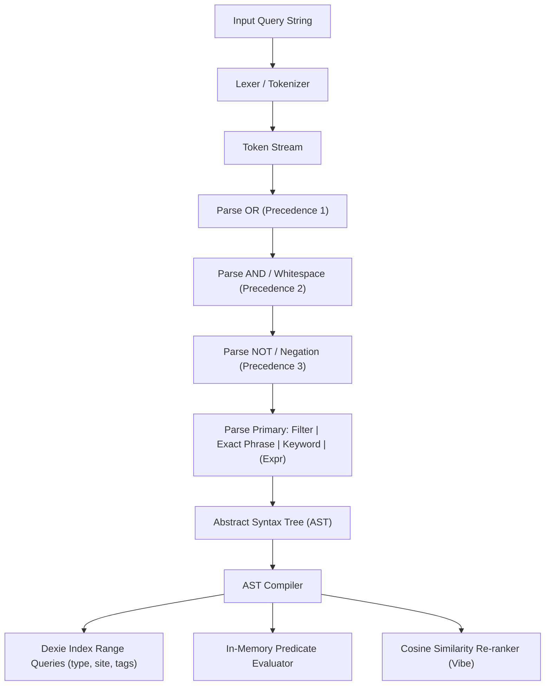

# Mymind Systems Architecture & Engine Blueprint
**Role:** Lead Systems Architect & Engine Designer  
**Target:** Production-Grade Mymind Recreation + Next-Gen Features  
**Directory:** `c:\Users\pc\Desktop\mymind`  

---

## 1. Executive Summary & Technology Stack

The Mymind architecture delivers a local-first, privacy-first, zero-organizing mind extension designed to mirror the refined editorial aesthetics of Mymind (`Louize` serif, `Maison Neue` grotesque, `#fbfaf8` warm canvas) while introducing powerful next-gen capabilities.

### 1.1 Technology Stack Matrix

- **Build & Framework:** Vite + React 18/19 + TypeScript (Strict mode)
- **Styling & Motion:** Tailwind CSS + CSS Variables + Framer Motion
- **Icons:** Lucide React
- **Local Storage Engine:** Dexie.js (IndexedDB 4.x) with multi-index compound stores
- **Search & Lexing Engine:** Custom Recursive Descent Parser + AST Compiler + Bitmask Index
- **Multi-Threading:** Dedicated Web Workers (`aiIndexer.worker.ts`, `vector.worker.ts`)
- **Semantic Vector Engine:** Dual-Tier (128D Lightweight Perceptual Vector + ONNX Runtime / Transformers.js `all-MiniLM-L6-v2`)
- **Reading & Markdown:** Mozilla Readability + Turndown + Markdown-it

---

## 2. Directory & File Structure

```text
c:\Users\pc\Desktop\mymind\
├── index.html
├── package.json
├── tsconfig.json
├── vite.config.ts
├── tailwind.config.js
├── public/
│   └── assets/
│       └── fonts/                       # Louize & Maison Neue WOFF2 fonts
└── src/
    ├── main.tsx
    ├── App.tsx
    ├── index.css
    ├── types/                           # Universal TypeScript Definitions
    │   ├── card.ts                      # Card, Metadata, Media, ColorPalette
    │   ├── search.ts                    # AST nodes, Tokens, FilterCriteria, SearchResult
    │   ├── tag.ts                       # Tag, TagReasoning, VisibleAIExplanation
    │   ├── space.ts                     # Space, SmartSpace, CanvasLayout
    │   ├── workspace.ts                 # Workspace, Member, Role
    │   ├── mindlink.ts                  # MindLink, GraphNode, GraphEdge
    │   ├── worker.ts                    # Worker request/response message contracts
    │   └── export.ts                    # Import/Export interchange schemas
    │
    ├── core/                            # Core Database & Repositories
    │   ├── db.ts                        # Dexie database instance & table schemas
    │   ├── cardRepository.ts            # High-performance CRUD & indexing
    │   ├── tagRepository.ts             # Tag counts, confidence aggregates
    │   ├── spaceRepository.ts           # SmartSpace queries & manual collections
    │   ├── workspaceRepository.ts       # Workspace switching & scoping
    │   └── mindLinkRepository.ts        # Graph traversal & bidirectional backlinks
    │
    ├── engine/                          # Core Algorithmic Engines
    │   ├── search/                      # Search Query Parser & AST Engine
    │   │   ├── lexer.ts                 # Tokenizer for operators, quotes, prefixes, tags
    │   │   ├── ast.ts                   # Abstract Syntax Tree node definitions
    │   │   ├── parser.ts                # Recursive descent parser with operator precedence
    │   │   ├── compiler.ts              # Compiles AST into Dexie queries + memory predicates
    │   │   ├── highlighter.ts           # Snippet extraction & search hit highlighting
    │   │   └── index.ts                 # Search engine public facade
    │   │
    │   ├── ai/                          # AI Enrichment Pipeline
    │   │   ├── colorExtractor.ts        # Canvas downsampler, median-cut quantization, CIELAB naming
    │   │   ├── colorDictionary.ts       # 150+ named design colors & RGB/Lab centroids
    │   │   ├── typeClassifier.ts        # Heuristic & metadata multi-stage type classifier
    │   │   ├── reasoningTagger.ts       # "Why this tag" rules, heuristics & confidence scoring
    │   │   ├── readingTime.ts           # WPM calculator & reading complexity estimator
    │   │   ├── summarizer.ts            # Client-side TextRank / centroid extractive summarizer
    │   │   ├── articleExtractor.ts      # Mozilla Readability + Turndown markdown transformer
    │   │   ├── vectorEmbedder.ts        # 128D hybrid perceptual vector & Transformers.js adapter
    │   │   └── similarityEngine.ts      # Vector cosine similarity, Top-K heap & "Same Vibe" matcher
    │   │
    │   └── rag/                         # Ask Your Library RAG Engine
    │       ├── contextRetriever.ts      # Semantic Top-K chunk retrieval
    │       ├── promptComposer.ts        # Synthesis prompt generator
    │       └── ragEngine.ts             # Local/cloud LLM query executor
    │
    ├── workers/                         # Multi-Threaded Processing
    │   ├── aiIndexer.worker.ts          # Color analysis, tagging, classification, summarization
    │   ├── vector.worker.ts             # Cosine similarity clustering, 50k card vector search
    │   └── workerManager.ts             # Main-thread pool manager with Promise-based dispatch
    │
    ├── services/                        # Application Services
    │   ├── captureService.ts            # URL metadata sniffing, OpenGraph, Twitter/YouTube scraper
    │   ├── importExportService.ts       # Raindrop, Pocket, Notion, JSON, Markdown zip pipeline
    │   └── clipboardService.ts          # Automatic paste detector (image, rich HTML, URL)
    │
    ├── hooks/                           # Custom React Hooks
    │   ├── useCards.ts                  # Reactive LiveQuery card subscription
    │   ├── useSearch.ts                 # Query state, chained tokens, AST execution, debouncing
    │   ├── useSpaces.ts                 # Active space & smart space manager
    │   ├── useMindLinks.ts              # Graph backlinks and forward links
    │   ├── useKeyboardShortcuts.ts      # Global Mymind keyboard shortcuts (`/`, `N`, `Esc`, `Space`)
    │   └── useWorkspace.ts              # Workspace context & permissions
    │
    └── components/                      # Modular UI Components
        ├── shell/                       # Header, SearchBar, Chained Token Pills, Workspace Modal
        ├── deck/                        # Virtualized fluid masonry grid & card renderers
        ├── detail/                      # Card Inspector, Visible AI Inspector, Reading Mode
        ├── canvas/                      # Infinite Canvas Moodboard with visual MindLinks
        ├── serendipity/                 # Serendipity 3-card associative shuffle
        ├── rag/                         # Ask Your Library conversational drawer
        └── capture/                     # Quick capture modal & drag-and-drop zone
```

---

## 3. Search Query Parser & AST Implementation Details

### 3.1 Operator Grammar & Token Hierarchy

The parser handles complex user queries without requiring technical syntax from casual users while rewarding power users:

1. **Chained Token Pills:** Multi-word concepts committed via `Enter` or comma (e.g., `[interior design] [scandinavian] [orange]`) become contiguous AND-joined nodes.
2. **Boolean Logic:** Explicit `&&` (AND), `||` (OR), grouping `(...)`, and negation `-` or `!` (e.g. `furniture || interior -plastic`).
3. **Exact Phrases:** `"modernist architecture"` tests exact substring matches across title, excerpt, full-text, and OCR text.
4. **Typed Filter Operators:**
   - `type:article`, `type:quote`, `type:product`, `type:book`, `type:note`, `type:todo`, `type:image`, `type:video`, `type:code`, `type:audio`, `type:pdf`
   - `format:pdf`, `format:image`, `format:video`
   - `site:youtube`, `site:github`, `site:nytimes`
   - `tag:name`, `#name`, `-#draft`
   - `color:orange`, `color:#E05A47` (evaluates $\Delta E$ color distance)
   - `object:chair`, `object:car` (vision object tags)
   - `text:login` (OCR in-image text)
   - `action:read`, `action:buy`
   - `completed:true`, `completed:false`
5. **Semantic Similarity Operator:**
   - `|| interior design` or `vibe:"warm cozy cafe"` triggers 128D/384D cosine similarity ranking.

### 3.2 Recursive Descent Parser Flow



---

## 4. AI Enrichment Pipeline Specifications

### 4.1 Client-Side Color Palette Extraction
- Downsamples images to $64 \times 64$ via OffscreenCanvas.
- Runs Modified Median-Cut Quantization to isolate the top 5 dominant and accent colors.
- Computes CIELAB $\Delta E$ against 150+ named design shades (e.g., Terracotta, Warm Ochre, Forest Pine, Midnight Blue).
- Output: `dominant`, `vibrant`, `muted`, `darkVariant`, `lightVariant`, `hexPalette`, `colorNames`.

### 4.2 Auto-Categorizer
Multi-stage decision tree identifying content types:
- **Product:** OpenGraph `og:price:amount`, currency regex (`$`, `€`, `£`), shopping domains.
- **Book:** ISBN format, `"by [Author]"`, Goodreads/Google Books.
- **Quote:** Short text ($< 400$ chars), quote marks, author em-dash attribution.
- **Todo:** Markdown checkboxes `- [ ]`.
- **Code:** Syntax language blocks, GitHub Gists.
- **Article:** Length $> 600$ words with structured headings and paragraphs.

### 4.3 Visible AI ("Why this tag?" & Confidence)
Every auto-generated tag includes an explicit explainability record:
```typescript
{
  name: "terracotta",
  confidence: 0.94,
  source: "color_vision",
  reason: "Color analysis detected warm terracotta (#D45B3A, 42% area)"
}
```

### 4.4 Dual-Tier Vector Similarity ("Same Vibe")
- **Tier 1 (Instant):** 128-dimensional normalized dense feature vector fusing:
  - 32D Color HSL distribution
  - 16D Content category one-hot
  - 64D Hashed lexical n-gram TF-IDF
  - 16D Structural complexity (aspect ratio, reading time, word count)
- **Tier 2 (Async / High-Fidelity):** 384D ONNX WebAssembly Transformers.js embedding.
- Fast Top-K min-heap cosine similarity running in `vector.worker.ts`.

---

## 5. Complete Data Schema (TypeScript)

Full schemas defined for:
- `Card` (all 11 card types, media, metadata, color palette, reading time, tags, mindLinks)
- `Tag` (slug, count, user vs auto, suggested color)
- `Space` / `SmartSpace` (query-driven automatic spaces, freeform canvas coordinates)
- `Workspace` (Personal vs Team, permissions, member counts)
- `Comment` (collaborative card notes)
- `ActivityLog` (auditing changes, tagging, mindlink creation)
- `MindLink` (bi-directional graph edges with context snippets)
